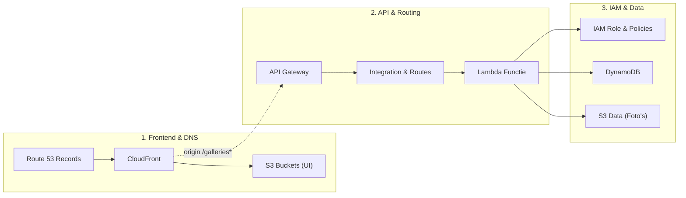
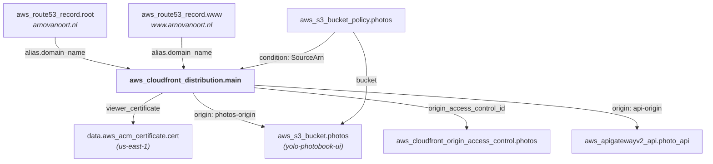
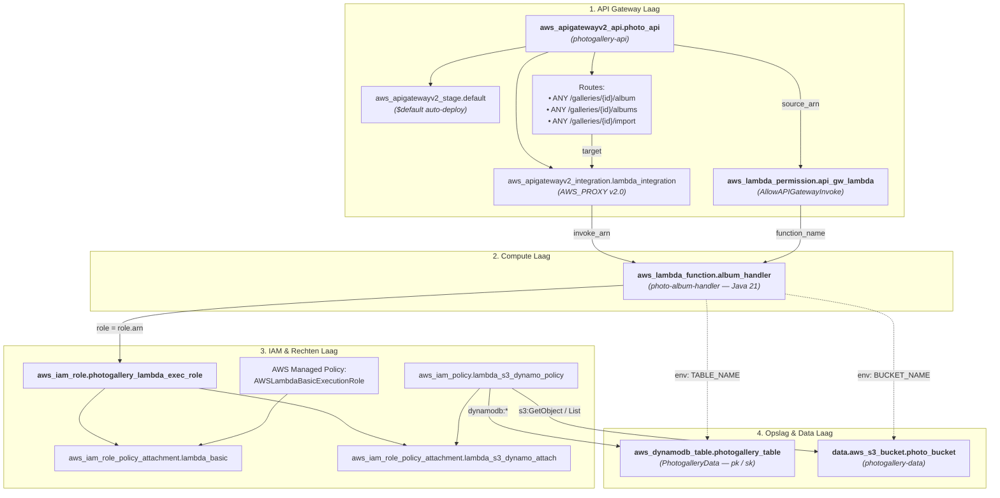

# 🏗️ Terraform Resource Dependencies & Architectuur

Dit document toont **exact welke Terraform-resource afhangt van welke andere resource** (de dependency tree), opgeknipt in overzichtelijke, leesbare delen.

---

## 1. Hoofdlijnen: De 3 Lagen (Compact)

In plaats van één gigantisch diagram, toont dit overzicht hoe de drie functionele blokken van elkaar afhangen:

---

## 2. Deeldiagram A: Frontend, DNS & CloudFront

Dit diagram toont uitsluitend de frontend- en CDN-resources en hun directe dependencies:

---

## 3. Deeldiagram B: Backend (API Gateway ➡️ Lambda ➡️ IAM ➡️ Data)

Om kruisende pijlen te voorkomen stroomt dit diagram **strikt van boven naar beneden**:
1. **API Gateway & Routing** (boven)
2. **Lambda Compute** (midden)
3. **IAM Autorisatie** (midden-onder)
4. **Opslag: DynamoDB & S3** (onder)

---

## 4. Complete Resource Dependency Matrix

In deze tabel staat voor **elke resource** exact beschreven waar hij op wacht/bouwt, en welk veld gebruikt wordt:

| Terraform Resource | Hangt direct af van (Dependencies) | Gebruikt attribuut |
|---|---|---|
| `aws_route53_record.root` | `data.aws_route53_zone.main` `aws_cloudfront_distribution.main` | `zone_id` `domain_name`, `hosted_zone_id` |
| `aws_route53_record.www` | `data.aws_route53_zone.main` `aws_cloudfront_distribution.main` | `zone_id` `domain_name`, `hosted_zone_id` |
| `aws_cloudfront_distribution.main` | `data.aws_acm_certificate.cert` `aws_s3_bucket.photos` `aws_cloudfront_origin_access_control.photos` `aws_apigatewayv2_api.photo_api` | `arn` `bucket_regional_domain_name` `id` `id` (voor API domain name) |
| `aws_s3_bucket_policy.photos` | `aws_s3_bucket.photos` `aws_cloudfront_distribution.main` | `id` `arn` (in condition SourceArn) |
| `aws_s3_bucket_public_access_block.photos` | `aws_s3_bucket.photos` | `id` |
| `aws_s3_bucket_policy.demo` | `aws_s3_bucket.demo` `aws_cloudfront_distribution.main` | `id` `arn` (in condition SourceArn) |
| `aws_apigatewayv2_stage.default` | `aws_apigatewayv2_api.photo_api` | `id` |
| `aws_apigatewayv2_integration.lambda_integration` | `aws_apigatewayv2_api.photo_api` `aws_lambda_function.album_handler` | `id` `invoke_arn` |
| `aws_apigatewayv2_route.album_route` | `aws_apigatewayv2_api.photo_api` `aws_apigatewayv2_integration.lambda_integration` | `id` `id` |
| `aws_apigatewayv2_route.albums_route` | `aws_apigatewayv2_api.photo_api` `aws_apigatewayv2_integration.lambda_integration` | `id` `id` |
| `aws_apigatewayv2_route.import_route` | `aws_apigatewayv2_api.photo_api` `aws_apigatewayv2_integration.lambda_integration` | `id` `id` |
| `aws_lambda_permission.api_gw_lambda` | `aws_lambda_function.album_handler` `aws_apigatewayv2_api.photo_api` | `function_name` `execution_arn` |
| `aws_lambda_function.album_handler` | `aws_iam_role.photogallery_lambda_exec_role` `aws_dynamodb_table.photogallery_table` `data.aws_s3_bucket.photo_bucket` | `arn` `name` (in env var) `id` (in env var) |
| `aws_iam_role_policy_attachment.lambda_basic` | `aws_iam_role.photogallery_lambda_exec_role` | `name` |
| `aws_iam_policy.lambda_s3_dynamo_policy` | `data.aws_s3_bucket.photo_bucket` `aws_dynamodb_table.photogallery_table` | `arn` `arn` |
| `aws_iam_role_policy_attachment.lambda_s3_dynamo_attach` | `aws_iam_role.photogallery_lambda_exec_role` `aws_iam_policy.lambda_s3_dynamo_policy` | `name` `arn` |
| `aws_s3_bucket_public_access_block.photo_bucket_block` | `data.aws_s3_bucket.photo_bucket` | `id` |
